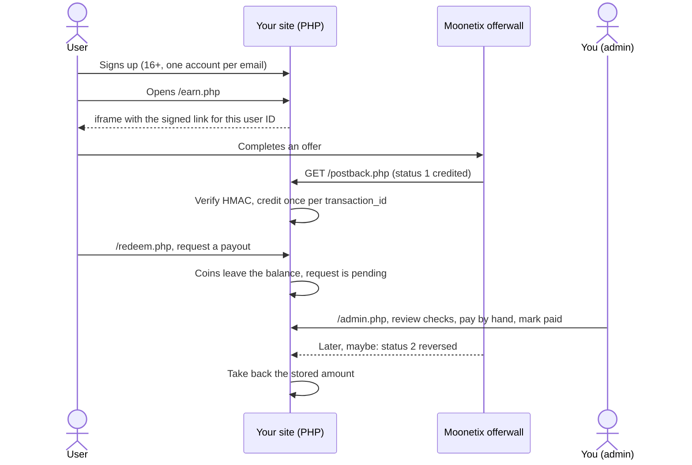

# Rewards site starter (PHP and SQLite)

**A small, real get-paid-to site: accounts, a balance, an Earn page with the Moonetix offerwall, verified postbacks, history, and redeem requests you approve by hand.**

[](https://github.com/moonetix/rewards-site-starter/actions/workflows/ci.yml)
[](LICENSE)
[](https://moonetix.com/industries/rewards-sites)
[](#run-it)
[](https://moonetix.com/academy/monetization/start-a-rewards-website)
[](https://moonetix.com/register?from=github-rewards-site-starter)
[](https://moonetix.com)

A rewards site pays users in its own currency for completed offers and keeps a share of what the advertiser pays. [Moonetix](https://moonetix.com) is an affiliate network that supplies those offers through its offerwall. This starter is plain PHP 8 with PDO SQLite: no framework, no Composer, about 1,100 lines you can read in an afternoon and run on any PHP host.

> **Get your App ID and keys: sign up free at https://moonetix.com/register?from=github-rewards-site-starter**

## What it already handles

1. **The money path.** Each Moonetix `transaction_id` is a primary key, so a retried postback cannot pay twice. A reversal takes back the stored amount, even after the coins were redeemed. Redeem requests take the coins at request time, so they cannot be spent twice, and nothing is paid automatically.
2. **The abuse you will see in week one.** One account per mailbox (case, `+tags` and Gmail dots ignored), rate limits on sign-up, login and redeem, a hold on fresh credits, and an admin list that shows account age, reversals and other accounts from the same sign-up IP next to every request.
3. **The boring security.** `password_hash`, CSRF tokens on every form, strict session mode with ID regeneration at login, idle and absolute timeouts, `__Host-` cookies on https, a Content Security Policy that only allows `wall.moonetix.com`, and output escaped everywhere.

## How it fits together



## Run it

PHP 8.1 or later with `pdo_sqlite` and `mbstring`.

```bash
git clone https://github.com/moonetix/rewards-site-starter.git
cd rewards-site-starter
cp .env.example .env          # Moonetix keys, ADMIN_EMAILS, currency, limits
php -S 127.0.0.1:8000 -t public
```

Open http://127.0.0.1:8000, sign up with the email you put in `ADMIN_EMAILS`, and you have an admin account.

In production, point the web server's document root at `public/` (never at the project root), serve it over https, and keep `data/` writable by PHP and outside the web root. Then save this postback URL on the Postback page of your Moonetix dashboard:

```text
https://YOUR_DOMAIN/postback.php?tx={transaction_id}&user={user_id}&reward={reward}&status={status}&offer={offer_name}&hash={hash}
```

| Setting | Default | What it does |
| --- | --- | --- |
| `MOONETIX_APP_ID`, `MOONETIX_LINK_SALT` | | From Offerwalls, your offerwall, Integration |
| `MOONETIX_POSTBACK_KEY` | | From the Postback page |
| `ADMIN_EMAILS` | | Comma-separated accounts that may open `/admin.php` |
| `CURRENCY_NAME`, `SITE_NAME` | `Coins`, `Rewards Starter` | Shown on every page |
| `REDEEM_MIN_COINS` | `1000` | Smallest request |
| `REDEEM_HOLD_DAYS` | `3` | Fresh credits are not redeemable for this many days |
| `REDEEM_METHODS` | `PayPal,Amazon gift card` | Options on the redeem form |
| `REGISTER_LIMIT_PER_HOUR`, `LOGIN_LIMIT_PER_15_MIN` | `3`, `10` | Per IP, and per account for logins |
| `CLIENT_IP_HEADER` | empty | `CF-Connecting-IP` behind Cloudflare |
| `MOONETIX_CREDIT_TEST_POSTBACKS` | `false` | `true` credits dashboard test postbacks |
| `DATABASE_PATH` | `data/rewards.sqlite` | SQLite file. A relative path is resolved from the project root, not from `public/`. |
| `SESSION_SECURE` | `auto` | `auto` sets secure `__Host-` cookies when the request is https or `X-Forwarded-Proto: https`. `true` or `false` forces it. |

Real environment variables win over `.env`. The three `MOONETIX_*` keys have no default: without the postback key the endpoint answers `500 not configured`.

Set your conversion rate and user split in the Moonetix dashboard (Offerwalls, your offerwall, Rewards). `{reward}` arrives already in your currency.

## How it works

1. **Sign-up** (`register.php`): valid email, password of 10 to 200 characters, 16+ confirmation, accepted terms. The canonical email is unique, so `Jane.Doe+x@gmail.com` and `janedoe@gmail.com` are one account.
2. **Earn** (`earn.php`): the user ID is the account ID from the session. The page embeds `https://wall.moonetix.com/{APP_ID}?user_id={id}&hash={HMAC-SHA256(id, salt)}&sub1=earn_page`.
3. **Postback** (`postback.php`): reads the raw query string so a repeated `tx` cannot slip through (PHP's `$_GET` keeps the last copy), checks the HMAC with `hash_equals` first, then credits or reverses inside `BEGIN IMMEDIATE`. 403 for a bad hash, 400 for signed nonsense, 200 after the commit, 500 on errors so Moonetix retries.
4. **History** (`history.php`): every balance change from the ledger, including reversals and redeem requests.
5. **Redeem** (`redeem.php`): minimum, one pending request per user, only coins past the hold. The amount leaves the balance at once.
6. **Admin** (`admin.php`): pending requests with the checks that matter before paying. Pay through your provider, then mark the request paid. Rejecting returns the coins.
7. **Legal pages** (`terms.php`, `privacy.php`): placeholders that already name the points a rewards site needs: age, one account per person, reversals, holds, and that offerwall data goes to Moonetix. Replace them with your own text before launch.

| Path | Purpose |
| --- | --- |
| `src/moonetix.php` | Link signing, strict query parsing, hash check, exact amounts |
| `src/ledger.php` | Postbacks, hold, redeem requests, admin decisions |
| `src/bootstrap.php` | Config, sessions, CSRF, auth helpers |
| `src/db.php` | Schema, transactions, rate limits |
| `public/` | The pages and the postback endpoint |

## Security notes

- The link hash salt and postback key come from the environment or `.env`, which is outside `public/` and ignored by Git.
- Never trust a user ID from the browser. The Earn page reads it from the session; postbacks are trusted only after the hash check.
- Only `{reward}` is signed. The offer name is stored for the history page and never affects an amount.
- Amounts are integers in millionths of a coin. No floats touch a balance.
- A reversal can make a balance negative. The terms placeholder says so; keep that clause.
- This starter does not pay anyone. Every payout is a human decision in `/admin.php`.
- Reward only completed offers, never sign-ups to your own site, invites, likes or reviews. Users must be 16 or older.
- Before you grow, add email verification and a CAPTCHA on sign-up. See [Stop fake sign-ups on a rewards site](https://moonetix.com/academy/traffic-quality/stop-fake-signups-rewards-site). [signup-guard](https://github.com/moonetix/signup-guard) has a PHP port of the disposable email, datacenter IP and velocity checks.

## Test it

```bash
php tests/run.php
```

The runner calls the code directly, then starts the site on PHP's built-in server with 4 workers and drives it over HTTP with curl: 71 checks, including CSRF and cross-origin posts, the one-account rule, the login rate limit, the signed iframe link, credits, retries, decimals, 20 parallel copies of one postback, reversals before and after redeeming, a reversal before its credit, tampered and repeated postbacks, the hold, redeem rules, admin access, paid and rejected requests, logout, and a server log free of PHP warnings.

To check a deployed copy from the outside, run [postback-tester](https://github.com/moonetix/postback-tester). It signs postbacks the way Moonetix does and sends a credit and its retry, three kinds of reversal, four forged or unsigned postbacks and five parallel copies of one credit. Its transaction IDs start with `test_`, so set `MOONETIX_CREDIT_TEST_POSTBACKS=true` while it runs and pass your own account ID:

```bash
export MOONETIX_POSTBACK_KEY=your-postback-secret-key
npx github:moonetix/postback-tester --preset moonetix \
  'https://YOUR_DOMAIN/postback.php?tx={transaction_id}&user={user_id}&reward={reward}&status={status}&offer={offer_name}&hash={hash}' --user 1
```

With Moonetix:

1. Offerwalls, your offerwall, Integration: under Integration status, **Check a link** and **Test a link** for your account ID must match the iframe `src` on `/earn.php`.
2. Click **Send a test postback**, or use the Postback page. The endpoint answers `test postback, not credited`. To see a test credit in your balance, set `MOONETIX_CREDIT_TEST_POSTBACKS=true` for a moment and send it to your own account ID.
3. Every attempt and your server's answer is listed under Reports, Postbacks.
4. Remove test rewards before launch, and open the offerwall from a normal home or mobile connection: VPNs and data center networks see a block page.

## Troubleshooting

`postback.php` answers in plain text, and Reports, Postbacks shows that text next to the status code. Details go to the PHP error log.

| Answer | Cause | Fix |
| --- | --- | --- |
| `403 missing or repeated parameter` | `tx`, `user`, `reward`, `status` or `hash` is absent or appears twice. | Copy the postback URL above exactly, with each macro once. |
| `403 invalid hash` | Wrong key, or a value changed on the way. | Use the postback secret key, not the link hash salt. Paste the logged URL into the [hash checker](https://moonetix.com/tools/postback-hash-checker). |
| `400 bad values` | Signed, but the status is not 1 or 2, the reward is not a plain number, or `tx` is over 255 characters. | Check that each macro sits behind the right parameter name. |
| `500 not configured` | `MOONETIX_POSTBACK_KEY` is empty. | Set it in `.env` or in the PHP-FPM pool environment. |
| `500 try again` | The database write failed, usually because PHP cannot write to `data/`. | Give the PHP user write access to the folder of `DATABASE_PATH`. Moonetix retries. |
| `200 unknown_user` or `200 ignored: unknown user` | The user ID is not an account ID on this site, for example `test_user`. | Expected for dashboard tests to other IDs. Real links carry the account ID. |
| "Session expired" on every form | The `Origin` of the post does not match the `Host` header, often a reverse proxy that rewrites `Host`. | Pass the original `Host` through to PHP. |
| `403` on `/admin.php` | The signed-in email is not in `ADMIN_EMAILS`. | Add it, comma-separated, and reload. |

## Learn more

- Academy: [How to start a rewards (GPT) website](https://moonetix.com/academy/monetization/start-a-rewards-website)
- Academy: [Reward hold periods](https://moonetix.com/academy/monetization/reward-hold-periods), [Rewards site payout methods](https://moonetix.com/academy/monetization/rewards-site-payout-methods), [Rewards site terms of service](https://moonetix.com/academy/monetization/rewards-site-terms-of-service), [Offerwall privacy policy clause](https://moonetix.com/academy/publisher-basics/offerwall-privacy-policy-clause)
- Academy: [Prevent duplicate reward credits](https://moonetix.com/academy/integrations/prevent-duplicate-reward-credits) and, on WordPress instead, [Build a rewards site on WordPress](https://moonetix.com/academy/monetization/build-a-rewards-site-on-wordpress)
- Docs: [Offerwall link](https://docs.moonetix.com/offerwall-link), [Postbacks](https://docs.moonetix.com/postbacks), [Rewards and currency](https://docs.moonetix.com/rewards), [Credits and reversals](https://docs.moonetix.com/credits-and-reversals), [Testing](https://docs.moonetix.com/testing)
- Moonetix for [rewards sites](https://moonetix.com/industries/rewards-sites) and [websites](https://moonetix.com/integrations/website)
- Tools: [rewards site profit calculator](https://moonetix.com/tools/rewards-site-profit-calculator), [virtual currency calculator](https://moonetix.com/tools/virtual-currency-calculator)

## Start earning

**Get your App ID and keys: sign up free at https://moonetix.com/register?from=github-rewards-site-starter**

Every publisher application is reviewed by hand. Once your site is approved, set your currency and rate, paste the keys into `.env`, and send a test postback.


## More Moonetix examples

| Repository | What it covers |
| --- | --- |
| [awesome-offerwalls](https://github.com/moonetix/awesome-offerwalls) | Curated list of offerwall networks, tools and guides |
| [offerwall-postback-handlers](https://github.com/moonetix/offerwall-postback-handlers) | Postback handlers in PHP, Node.js, Python and Java |
| [offerwall-nextjs-starter](https://github.com/moonetix/offerwall-nextjs-starter) | Next.js App Router starter |
| [telegram-mini-app-offerwall](https://github.com/moonetix/telegram-mini-app-offerwall) | Telegram Mini App with server-side `initData` checks |
| [discord-rewards-bot](https://github.com/moonetix/discord-rewards-bot) | Discord bot with an economy and offerwall rewards |
| [moonetix-offerwall-wordpress](https://github.com/moonetix/moonetix-offerwall-wordpress) | WordPress plugin |
| [offerwall-laravel](https://github.com/moonetix/offerwall-laravel) | Laravel integration |
| [offerwall-django](https://github.com/moonetix/offerwall-django) | Django integration |
| [offerwall-express](https://github.com/moonetix/offerwall-express) | Express integration |
| [postback-tester](https://github.com/moonetix/postback-tester) | Sends signed test postbacks and catches double credits, missed reversals and forged requests |
| [signup-guard](https://github.com/moonetix/signup-guard) | Sign-up risk checks for Node.js and PHP: disposable emails, datacenter and Tor IPs |
| [datacenter-ip-ranges](https://github.com/moonetix/datacenter-ip-ranges) | Daily cloud, Tor and iCloud Private Relay IP ranges from official feeds |
| [offerwall-fraud-playbook](https://github.com/moonetix/offerwall-fraud-playbook) | Fraud playbook for offerwall and rewards publishers, with tested code |
| [reward-economy-kit](https://github.com/moonetix/reward-economy-kit) | Integer points math: payout to points, bonuses, reversals, cash-out pricing |
| [referral-engine](https://github.com/moonetix/referral-engine) | Referral codes, attribution and a clawback-safe commission ledger |
| [gamification-kit](https://github.com/moonetix/gamification-kit) | Streaks, XP levels, quests and leaderboards that survive time zones and DST |
| [affiliate-postback-macros](https://github.com/moonetix/affiliate-postback-macros) | Postback macros and signatures of tracking platforms and offerwalls |
| [country-tiers](https://github.com/moonetix/country-tiers) | Tier 1, 2 and 3 countries as JSON and CSV, with helpers in JavaScript, PHP and Python |

## License

MIT. See [LICENSE](LICENSE).
